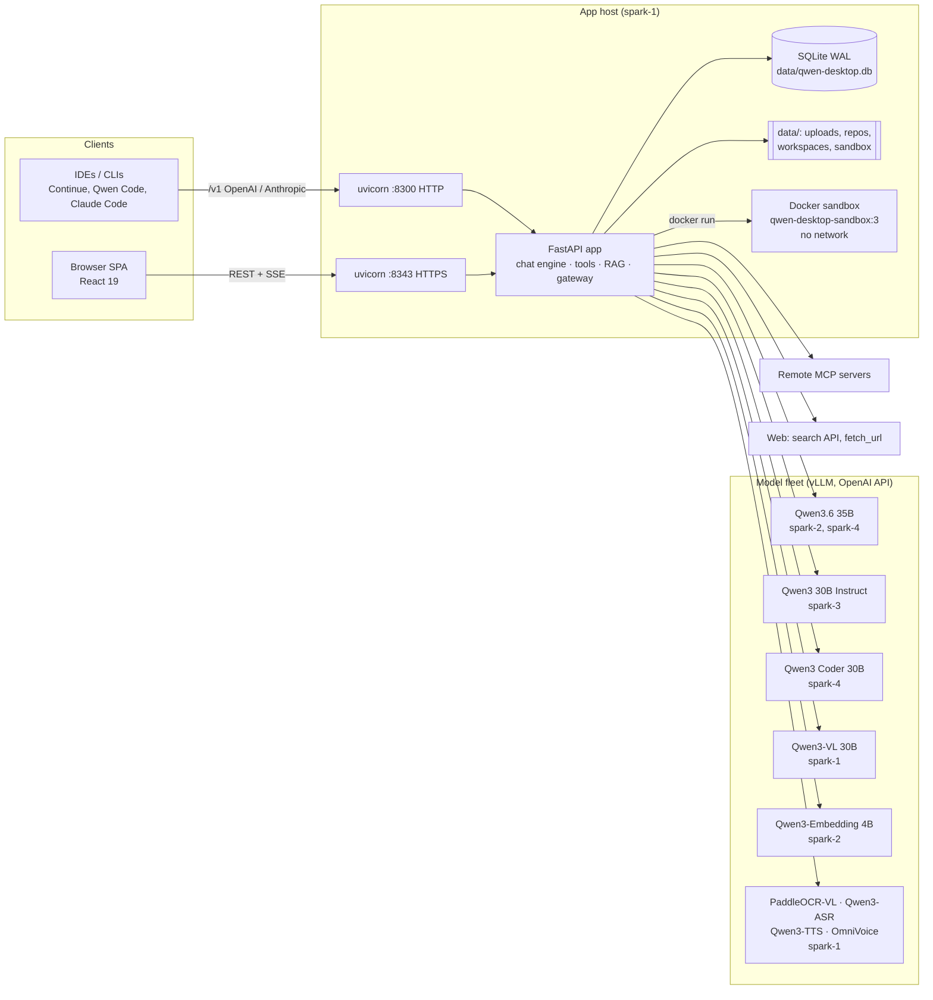

# Qwen Desktop

A self-hosted, multi-user AI workspace for the Qwen model fleet on the DGX Spark cluster: chat with
tools, project knowledge bases (RAG over documents and code), agentic coding in sandboxed server-side
workspaces, MCP connectors and an OpenAI/Anthropic-compatible API gateway for IDEs and coding agents.
Nothing leaves the network: every model runs on the cluster.

**Stack:** FastAPI (Python 3.12, asyncio) · SQLite (WAL, FTS5) · React 19 + TypeScript (Vite, zustand) ·
Docker sandbox · vLLM (OpenAI-compatible) model servers.

---

- [Architecture](#architecture)
- [How a chat turn works](#how-a-chat-turn-works)
- [Getting started](#getting-started)
- [Configuration](#configuration)
- [Subsystems](#subsystems)
- [Security model](#security-model)
- [Data model](#data-model)
- [HTTP API](#http-api)
- [Operations](#operations)
- [Development](#development)
- [Limits](#limits)
- [Known limitations and roadmap](#known-limitations-and-roadmap)
- [Troubleshooting](#troubleshooting)

---

## Architecture



**Process model.** `start.sh` runs two uvicorn processes on the same code and database: plain HTTP on
`:8300` (for API clients, which reject self-signed certificates) and HTTPS on `:8343` (for browsers:
the microphone needs a secure context). They share state only through SQLite, so everything that must be
coordinated across them (repository indexing jobs, start-up migrations) uses database leases or
idempotent, race-safe statements. In-memory state (login throttle, health cache, gateway concurrency
limits, replica benching) is per process.

**Model routing.** `llm.py` keeps one pooled `httpx.AsyncClient` and a replica pool per model.
Requests round-robin across healthy replicas; a failing replica is benched for 20 s and the request
fails over **before the first token is streamed**, so users never see a half-answer from a dead node.

**Fleet** (from `config.yaml`):

| Model id | Served model | Replicas | Context | Capabilities |
|---|---|---|---|---|
| `qwen3.6-35b` (default) | qwen3.6-35b-a3b-fp8 | spark-2 :8001, spark-4 :8002 | 200k | tools, thinking |
| `qwen3-30b-instruct` | qwen-chat | spark-3 :8103 | 16k | tools; utility model (titles) |
| `qwen3-coder-30b` | qwen3-coder-30b-a3b | spark-4 :8003 | 64k | tools; default for workspace chats |
| `qwen3-vl-30b` | qwen3-vl-30b-a3b-fp8 | spark-1 :8011 | 16k | vision |
| embeddings | qwen3-embedding-4b (1024-d, Matryoshka-truncated) | spark-2 :8093 | | |
| OCR / ASR / TTS | paddleocr-vl-1.6 / qwen3-asr / Qwen3-TTS, OmniVoice | spark-1 :8012 / :8092 / :8094, :8091 | | |

## How a chat turn works

`POST /api/conversations/{cid}/messages` returns a Server-Sent Events stream. `ChatService.respond`
(`backend/app/chat.py`):

1. **Persist the user message** (with attachments, the selected skill or shortcut as a snapshot, and
   secret-guard redactions already applied client-side) and emit `user_message`.
2. **Resolve the model.** Images in history are routed: a vision model gets the latest two images
   natively; any other model gets a cached Qwen3-VL description per image and the `analyze_image` tool.
3. **Assemble the system prompt:** base instructions, the user's custom instructions, project
   instructions, project knowledge (inlined while it fits in 35% of the context, otherwise hybrid
   retrieval of the top 8 chunks), repository layout, workspace hints, the skills catalogue, connector
   descriptions and tool guidance.
4. **Fit the context budget:** `context − max_tokens − system − tool schemas`. The turns after the
   conversation's rolling summary are sent verbatim while they fit. When they don't, the older turns are
   folded into the summary first (see [Long conversations](#long-conversations--summarypy)). Whole turns
   only; the latest turn is always kept and the verbatim window always starts on a user turn.
5. **Build the tool set** for this turn: built-ins (web, fetch, vision, knowledge, code, sandbox,
   workspace), `use_skill`, and `mcp__<server>__<tool>` for each connector the user switched on.
6. **Agent loop.** Stream the completion; on `tool_calls`, run the tools concurrently (each with its
   own timeout), append the results and continue. The loop is capped at 12 rounds (20 with code
   repositories, 50 in a workspace). Each tool result kept in history is capped at 12,000 characters.
7. **Persist** the assistant message as content blocks (text, reasoning, tool calls with results and
   outputs) plus token usage, then emit `done`. A first message also triggers an asynchronous title
   from the utility model (`title`).

Stopping a reply keeps the partial answer. Editing a message or retrying truncates the history at that
point and re-runs the turn.

**SSE events:** `user_message`, `assistant_start`, `status` (progress text), `summary` (the rolling summary was updated), `block_start`
(text / reasoning / tool block), `delta` (token text), `tool_result`, `title`, `error`, `done`.
The frontend batches deltas per animation frame (`store/chat.ts`), so long streams don't re-render
per token.

## Getting started

### Prerequisites

| | Version | Used for |
|---|---|---|
| Python + [uv](https://docs.astral.sh/uv/) | 3.12, uv ≥ 0.4 | backend |
| Node.js + npm | ≥ 22 | frontend build |
| Docker | ≥ 24 | code sandbox (optional: analysis and workspaces are disabled without it) |
| git | any | repository import, workspaces |
| Model servers | vLLM, OpenAI-compatible | listed in `config.yaml` |

The user running the app must be able to run `docker` (member of the `docker` group).

### First-time setup

```bash
git clone git@github.com:Qasimali20/Qwen-Desktop.git qwen-desktop && cd qwen-desktop

(cd backend && uv sync)              # creates backend/.venv from uv.lock
(cd frontend && npm ci)              # installs from package-lock.json
./sandbox/build.sh                   # builds qwen-desktop-sandbox:3 (Python data stack, Node 22, git, …)

# HTTPS certificate for the LAN address (self-signed; browsers ask to accept it once)
mkdir -p data/certs && openssl req -x509 -newkey rsa:2048 -nodes -days 1200 \
  -keyout data/certs/key.pem -out data/certs/cert.pem -subj "/CN=qwen-desktop" \
  -addext "subjectAltName=IP:$(hostname -I | awk '{print $1}'),DNS:localhost"

(cd backend && .venv/bin/python -m app.cli create-user admin --admin)   # prompts for a password
```

Edit `config.yaml` to point at your model servers, then:

```bash
./start.sh          # builds the frontend if sources changed, starts :8300 and :8343
./start.sh dev      # backend with --reload + Vite dev server on :5173 (proxies /api)
./start.sh stop
```

Open `https://<host-ip>:8343` from other machines. The database schema is created and migrated on start-up.

### User management (CLI)

```bash
cd backend
.venv/bin/python -m app.cli create-user <username> [--admin]   # the first user claims pre-existing data
.venv/bin/python -m app.cli reset-password <username>
.venv/bin/python -m app.cli list-users
```

Everything else (create, disable, reset, delete users) is in **Admin → Users**.

## Configuration

`config.yaml` (path override: `QWEN_DESKTOP_CONFIG`). Validated by pydantic at start-up (`app/config.py`).

| Key | Purpose |
|---|---|
| `server.host`, `server.port`, `server.data_dir` | bind address, HTTP port, runtime state directory (default `./data`) |
| `chat_models[]` | `id`, `label`, `description`, `model` (served name), `replicas[]` (base URLs), `context`, `max_tokens`, `tools`, `thinking`, `vision`, `default` |
| `vision_model` | model used to describe images for non-vision models and for `analyze_image` |
| `workspace_model` | default model for new workspace chats (falls back to the default model) |
| `utility_model` | model for background chores (titles) |
| `embedding` | `base_url`, `model`, `dims` (vectors are truncated client-side; vLLM rejects `dimensions` for Qwen3-Embedding) |
| `ocr`, `asr` | `base_url`, `model` |
| `tts_voices[]` | `id`, `label`, `base_url`, `model`, `stream_pcm`, `sample_rate` |
| `web_search` | `provider`: `wikipedia` (default) \| `brave` \| `tavily` \| `searxng`; `api_key_env` (name of the env var holding the key); `url` (SearXNG) |
| `gateway` | `enabled`, `max_concurrent_per_user` (per process), `queue_timeout_s`, `max_body_mb`, `anthropic_default_model`, `max_keys_per_user`, `public_url` |

Web search defaults to Wikipedia because Google and DuckDuckGo are unreachable from this network and
scraped engines serve captchas. For full web search:

```yaml
web_search: { provider: brave, api_key_env: BRAVE_API_KEY }   # and export BRAVE_API_KEY before ./start.sh
```

## Subsystems

### Authentication and sessions — `auth.py`

- Passwords: scrypt (N=2¹⁴, r=8, p=1), minimum 8 characters. Unknown usernames are checked against a
  dummy hash so response time doesn't reveal which accounts exist.
- Sessions: random token in an `HttpOnly` cookie (`qd_session`); only its SHA-256 is stored.
  30-day sliding expiry, refreshed at most every 10 min.
- Throttling: 5 failures per username and 20 per client IP within 15 min (looser per IP because offices
  share NAT addresses).
- Changing your password signs out your other sessions; an admin reset signs out all of them. Disabling a user also
  blocks their API keys.

### Long conversations — `summary.py`

When a chat outgrows the model's context, older turns are condensed instead of silently dropped:

1. A summary is stored on the conversation (`conversations.context_summary`: text, the ID and seq of
   the last message it covers, and how many messages it folds in). The model receives it in the system
   prompt as `<conversation_summary>`, followed by the later turns verbatim.
2. Only turns after the summary are rendered. While they fit, nothing is summarised.
3. When they no longer fit, everything older than a window of 60% of the budget is folded into the
   summary, together with the previous summary, by the chat's own model (thinking off, temperature 0.2).
   This hysteresis means the next turns fit without summarising again. Simulated at 200k context with
   heavy turns of about 3.6k tokens each, the first summary comes at turn 46 and then about every 20 turns.
4. The summariser receives each message as a plain transcript: user text with excerpts of attached
   documents, and assistant text with tool calls and clipped results. Reasoning is left out. A large
   backlog is processed in pieces sized to the model's context, up to 12 per turn.
5. The prompt asks for fixed sections (goal and context, decisions, key facts, work done, open items,
   user preferences), exact values, no invented facts and no computed figures. The summary is capped at
   2,000 tokens, or a quarter of the budget on small-context models, and that space is reserved in the budget.
6. **Staleness:** editing or regenerating a message deletes it and every later message. A summary whose
   last covered message is gone is ignored, and `truncate_from`/`replace_from` also clear it in the
   same transaction.
7. **Failure:** if the summariser fails, the turn falls back to dropping the oldest turns and says so in
   a status line. The next turn tries again.

The chat shows a divider after the last summarised message ("N earlier messages summarised"), which
expands to the summary text.

### Tools — `tools.py`

| Tool | Available when | Notes |
|---|---|---|
| `web_search`, `fetch_url` | web search on | `fetch_url` resolves the host and refuses non-global addresses, re-checking each redirect hop (max 5, followed manually); 3 MB cap |
| `analyze_image` | images in chat, non-vision model | asks Qwen3-VL a question about a specific image |
| `search_knowledge` | project with documents or code | hybrid retrieval, returns cited passages |
| `read_file`, `list_files`, `grep_code` | project with repositories | read-only access to indexed code |
| `run_python`, `run_shell` | *Analyze* on, sandbox available | Docker sandbox (below) |
| `list_files`, `read_file`, `grep`, `edit_file`, `write_file`, `run_shell` | workspace chat | operate on the user's working copy |
| `use_skill` | skills exist | loads a playbook |
| `mcp__<server>__<tool>` | connector switched on | remote MCP tool |

A tool is an object with a JSON schema, a UI label, a timeout and an async `run(ctx, args)`. `ToolContext`
carries per-turn capabilities (HTTP client, images, knowledge searcher, sandbox runner, code index,
skills loader, dynamic `extra_tools`). Tool errors are returned to the model as text so it can recover.

### Knowledge base (RAG) — `knowledge.py`

- Documents are extracted (PyMuPDF; scanned pages, meaning fewer than 40 characters of text, go to
  PaddleOCR-VL at 150 DPI, 4 in parallel), chunked at 1,800 characters with 250 overlap, and embedded
  in the background (batches of 32, 4 concurrent).
- Retrieval is hybrid: cosine similarity over NumPy-held vectors and SQLite FTS5 BM25, 40 candidates
  each, fused with Reciprocal Rank Fusion (k = 60). Per-project vector matrices are cached (LRU, 16 projects).
- While a project's documents fit in 35% of the model's context they are inlined in full. Beyond that
  the project switches to retrieval mode: each question retrieves 8 chunks automatically, and the
  model can call `search_knowledge` for follow-ups. Answers cite `[file, p. N]`, and sources open the
  PDF at that page.

### Code repositories — `repos.py`

A project can import git repositories (HTTPS, optional branch and read-only token) or `.zip` uploads.
A background job fetches the files and filters them: it skips VCS and dependency directories, build
output, lockfiles, minified and generated files, binaries and anything in `.gitignore`. It then splits
code at definition boundaries (target 2,400 characters, between 600 and 4,000) and embeds the chunks.
Sync re-embeds only files whose content hash changed. Jobs hold a 90 s lease in the `repos` table, and
a sweeper in each process (every 30 s) resumes jobs whose lease expired, so a restart mid-index loses
nothing and the two server processes never run the same job. Tokens are stored server-side and never
returned by the API.

### Code sandbox — `sandbox.py`, `sandbox/`

Each run is a fresh container:

```
docker run --rm --network none --read-only --tmpfs /tmp:rw,exec,size=1g
  --memory 2g --memory-swap 2g --cpus 2 --pids-limit 512
  --cap-drop ALL --security-opt no-new-privileges --user <app uid>:<app gid>
  -v <scratch>:/work:rw -v <script dir>:/qd:ro [-v <attachments>:/work/data:ro]
```

- Default timeout 120 s; `run_shell` may ask for up to 600 s. At most 4 runs at once per process.
  Output is capped at 12,000 characters of stdout and 12 output files (50 MB). Figures and files
  written by the code are returned as downloadable attachments.
- The image (Python 3.12 with pandas, NumPy, matplotlib, scikit-learn, openpyxl, python-docx,
  python-pptx, reportlab, pypdf, pytest and ruff; Node 22 with npm, tsc and tsx; git, ripgrep, jq,
  sqlite3, make) is built from packages installed into `sandbox/site` on the host. Running pip inside
  `docker build` is too slow on this network.
- Word, PowerPoint, PDF and Excel requests are fulfilled by the model writing the file in the sandbox.

### Workspaces — `workspaces.py`

A workspace is a user's private writable copy of a project's code on the server, cloned from a
connected repository or started empty. Layout under `data/workspaces/<id>/`:

| Path | Contents | In the sandbox |
|---|---|---|
| `work/` | the working tree | `/work`, read-write |
| `git/` | the git directory, kept outside the tree | read-only |
| `ctl/` | server scratch | not mounted |

Keeping the git directory out of the writable tree means nothing the model writes (hooks, config) can
run in the server's own git commands. Host-side file tools reject `..` and never follow symlinks out of
the tree. Workspace shells get 4 GB of memory.

Edits are shown as diffs in the chat. The *Changes* panel offers per-file diffs, discard, `.patch` and
`.zip` download, and **Commit & push** to a new, validated branch name (never forced). Pushing needs a
repository token with write access and returns a link to open the pull request.

### Skills — `skills.py`, `skills/*.md`

Playbooks are Markdown files with frontmatter (`name`, `title`, `description`; body up to 12,000
characters). Nine are built in: frontend, backend, security-audit, devops, mlops, llmops, aiops,
agentops and architecture. Admins add team skills and users add personal ones; names are unique across
all three scopes. The system prompt lists only names and one-line descriptions (progressive disclosure),
and the model loads a playbook with `use_skill`. Picking a skill with `/` attaches the playbook to that
message as a snapshot, so editing a skill never rewrites past conversations.

### Connectors (MCP) — `connectors.py`

Admins register remote MCP servers (streamable HTTP or SSE, with optional headers such as
`Authorization`). The server is probed on creation, which rejects a bad URL or token, and its tool list
is cached and refreshed on demand. Each call opens a short-lived session (initialize → `tools/call` →
close), so no connection state is shared between the two server processes and a server restart never
leaves a chat stuck.

- Headers are stored server-side and never returned by the API; admins see header names only.
- Tools annotated `destructiveHint` start switched off, and admins can switch any tool on or off.
- At most 48 MCP tools per chat. The model is told to treat results as data, not instructions, and to
  confirm with the user before changing anything in an external system.

### API gateway — `gateway.py`

Personal API keys (`qd-…`; only a SHA-256 is stored, and the key is shown once) authenticate
OpenAI-compatible (`/v1/models`, `/v1/chat/completions`, `/v1/completions`, `/v1/embeddings`) and
Anthropic-compatible (`/v1/messages`, `/v1/messages/count_tokens`) endpoints. Model names are
aliased: `claude-*` maps to `gateway.anthropic_default_model`. Requests use the same replica pools and
failover as the app. Each user gets `max_concurrent_per_user` in-flight requests per process, and
further requests queue for up to `queue_timeout_s` and then get 429. Usage is recorded per key for the
admin console. *API keys & IDE setup* generates ready-to-paste configuration for Continue, Qwen Code
(macOS/Linux and Windows), Claude Code, curl and Python.

### Secret guard — `secretscan.py`, `frontend/src/lib/secrets.ts`

One rule set, mirrored in Python and TypeScript, detects:

- private keys
- provider tokens: AWS, GitHub, GitLab, OpenAI, Anthropic, Slack, Stripe, Google, Hugging Face and
  Qwen Desktop keys
- JWTs, bearer headers and credentials in URLs
- `password=` / `api_key:`-style assignments

Placeholders and code references such as `os.environ[...]` are ignored. The composer offers *Redact &
send*, *Send anyway* or *Edit*. Uploaded documents and indexed repository files are masked server-side.

### Also

- **Sharing:** read-only snapshot links (`/share/<token>`) for signed-in users; they can be updated or revoked.
- **Shortcuts:** `/command` prompt templates with `{{input}}`.
- **Shared projects:** private, *team can use* or *team can edit*. Access is re-checked on every message.
- **Voice:** dictation (Qwen3-ASR) and streamed PCM read-aloud (Qwen3-TTS / OmniVoice).
- **Artifacts panel:** live preview of HTML, SVG, Mermaid and Markdown.
- Full-text chat search, pinning, and light and dark themes.

## Security model

| Boundary | Control |
|---|---|
| Users ↔ each other | Every query is scoped by owner. Objects owned by someone else return **404**, not 403, so their IDs are not confirmed. Shared projects re-check access per message. |
| Model-generated code ↔ host | Docker with no network, read-only root, all capabilities dropped, `no-new-privileges`, non-root user, memory/CPU/PID limits, read-only input mounts. Workspace git directory mounted read-only and outside the tree. |
| Model ↔ internal network | `fetch_url` allows only globally routable addresses, checked on every redirect hop. |
| External content ↔ model | Tool and MCP results are framed as data; external actions require user confirmation (prompt-level). |
| Credentials at rest | Passwords: scrypt. Sessions and API keys: SHA-256 digests only. Repository tokens and MCP headers: stored server-side, never returned. Backups: mode 600. |
| Credentials in content | Secret guard before sending; masking of uploads and indexed code. |
| Accountability | Activity log of sign-ins (including failures and the reason), user, key, connector and team-content changes, with actor, time and IP. No secrets are logged. Kept 365 days. |

**Known gaps:**

- The HTTPS certificate is self-signed.
- The app user needs Docker access, which is root-equivalent on the host. Run the app on a dedicated
  machine or user.
- Repository tokens and MCP headers are stored in plain text in SQLite (protected by file permissions,
  not encryption).
- The OpenAPI schema (`/docs`, `/openapi.json`) is served without sign-in. It reveals routes, not data.
- The protection against model-driven external actions is an instruction to the model, not an
  enforced approval step.

## Data model

SQLite in WAL mode (`data/qwen-desktop.db`) with foreign keys on. The schema is in `db.py` and
migrations run idempotently on start-up.

| Area | Tables |
|---|---|
| Identity | `users`, `sessions`, `api_keys`, `user_settings` |
| Conversations | `conversations`, `messages` (content blocks and usage as JSON), `attachments` |
| Projects and RAG | `projects`, `chunks` (+ FTS5 index), `repos`, `repo_files`, `code_chunks` |
| Workspaces | `workspaces` |
| Sharing | `shares`, `share_attachments` |
| Team content | `prompts` (shortcuts), `skills` |
| Integrations | `mcp_servers` |
| Operations | `api_usage`, `audit_log`, `app_meta` |

Files live beside the database in `data/`:

| Path | Contents |
|---|---|
| `uploads/` | attachments and generated files |
| `repos/` | imported repositories |
| `workspaces/` | working copies |
| `sandbox/` | per-chat scratch folders |
| `certs/` | the HTTPS certificate and key |
| `logs/` | server logs |

## HTTP API

All `/api` routes need a session cookie, and `/api/admin/*` needs the admin role. `/v1` needs an API key
(`Authorization: Bearer qd-…` or `x-api-key`). There are 81 routes; the full schema is at `/docs`
(FastAPI OpenAPI).

| Area | Routes |
|---|---|
| Auth | `POST /api/auth/login`, `/logout`, `/password` · `GET /api/auth/me` |
| App | `GET /api/config` (models with live health, features) · `GET/PUT /api/settings` |
| Conversations | `GET/POST /api/conversations` · `GET/PATCH/DELETE /api/conversations/{cid}` · `POST …/{cid}/messages` (SSE) · `GET/POST/DELETE …/{cid}/share` |
| Files | `POST /api/uploads` · `GET /api/attachments/{aid}/content`, `/text` |
| Projects | CRUD on `/api/projects[/{pid}]` · `POST/DELETE /api/projects/{pid}/files[/{aid}]` |
| Repositories | `/api/projects/{pid}/repos`: list, `POST /git`, `POST /zip`, `PUT /{rid}/zip`, `POST /{rid}/sync`, `DELETE /{rid}`, `GET /{rid}/files`, `GET /{rid}/file` |
| Workspaces | `GET/POST /api/projects/{pid}/workspaces` · `/api/workspaces/{wid}`: `GET`, `DELETE`, `/changes`, `/diff`, `/patch`, `/archive`, `/discard`, `/commit`, `/push` |
| Skills, shortcuts | CRUD on `/api/skills`, `/api/prompts` |
| Connectors | `GET /api/connectors` · admin CRUD on `/api/admin/connectors` and `POST …/{sid}/refresh` |
| Keys | `GET/POST /api/keys` · `DELETE /api/keys/{kid}` · admin `GET/DELETE /api/admin/keys` |
| Admin | `/api/admin/users` CRUD · `GET /api/admin/usage`, `/activity`, `/health` |
| Voice | `POST /api/transcribe`, `/api/speak` |
| Shares | `GET /api/shares`, `/api/shares/{sid}` |
| Gateway | `GET /v1/models` · `POST /v1/chat/completions`, `/v1/completions`, `/v1/embeddings`, `/v1/messages`, `/v1/messages/count_tokens` |

## Operations

### Deploy a change

```bash
scripts/backup.sh      # take a backup first
./start.sh             # restarts both processes; rebuilds the frontend if src/ changed
```

A restart interrupts replies that are streaming at that moment. Partial replies are kept.

### Health — *Admin → Health*

`GET /api/admin/health` (`health.py`) runs these checks concurrently, each time-boxed, and the page
refreshes every 30 s:

- every replica of every model, including whether it serves the configured model
- embeddings, OCR, ASR and TTS servers
- the sandbox image and running containers
- the database (`PRAGMA quick_check`) and free disk space
- the age of the last backup (warning after 26 h, error after 50 h)
- the certificate's expiry (warning under 30 days)
- the running git commit
- connector status and the web search provider
- failed sign-ins in the last 24 h

### Logs

`data/logs/http.log` and `https.log` are timestamped (`backend/logging.yaml`) and appended across
restarts. `start.sh` rotates any log over 20 MB at start-up and keeps 5 old copies. *Admin → Activity* is
the audit trail for user and admin actions.

### Backups

`scripts/backup.sh` runs nightly at 02:15 from the app user's crontab and writes
`/home/tmc/qwen-desktop-backups/nightly/qwen-desktop-<timestamp>.tgz` (mode 600), keeping the newest 14
(`KEEP=` overrides). Each archive contains:

- a consistent copy of the database, made with the SQLite online backup API while the servers run and
  then `integrity_check`ed
- `uploads/`, `workspaces/`, `repos/`, `sandbox/` and `certs/`
- `config.yaml`
- a git bundle of all branches, plus any uncommitted changes as a patch

A `flock` prevents overlapping runs. Output goes to `backup.log` in the same folder. The archives sit on
the app's own disk, so copy them to another machine for protection against disk loss.

Restore:

```bash
./start.sh stop
mkdir /tmp/restore && tar -C /tmp/restore -xzf /home/tmc/qwen-desktop-backups/nightly/qwen-desktop-<timestamp>.tgz
mv data data.old && mkdir -p data/logs && cp -a /tmp/restore/data/. data/
git clone /tmp/restore/code.bundle /tmp/restore/code     # only if the code is needed too
./start.sh
```

### Upgrade the sandbox image

Change the package lists in `sandbox/build.sh` and bump the tag in `sandbox/build.sh`, `sandbox.py`
(`IMAGE`) and `start.sh`. Then run `./sandbox/build.sh` and `./start.sh`.

## Development

```bash
./start.sh dev                                     # API with --reload on :8300, Vite on :5173

cd backend
uv run --with pytest pytest -q tests               # backend tests
uvx ruff check app                                 # lint

cd frontend
npx tsc -b && npx oxlint src && npm run build      # type-check, lint, build
```

**Testing against real data without touching it:** copy the database with SQLite's `.backup`, point a
second config's `server.data_dir` at the copy, and run another instance:

```bash
QWEN_DESKTOP_CONFIG=/path/to/test-config.yaml backend/.venv/bin/uvicorn app.main:app --app-dir backend --port 8399
```

Create temporary accounts for tests and delete them afterwards.

**Conventions:**

- Start-up code must be race-safe, because two processes start at once on the same database.
- New tables and columns go into `SCHEMA` and the idempotent migrations in `db.py`.
- Anything that outlives an edit (skill or shortcut use) is snapshotted onto the message.
- APIs never return secrets.
- Secret-scanner test samples in `backend/tests/secret_cases.json` carry a `<>` marker inside each key
  prefix, which the test removes. This stops GitHub push protection and other scanners from taking
  them for live credentials, so keep new samples in the same form.

**Extending:**

- *Add a tool:* define a `Tool` in `tools.py` and add it to the tool-set builder in `chat.py`.
- *Add a skill:* drop a Markdown file with frontmatter into `backend/app/skills/`.
- *Add a model:* add an entry to `chat_models` and restart.

## Limits

| | Limit |
|---|---|
| Chat attachment text | 600k characters (inlined) |
| Project document | 8M characters (retrieved in chunks) |
| Images | longest edge scaled to 2,048 px; 2 sent natively per request to the vision model |
| Tool rounds per turn | 12 / 20 with repositories / 50 in a workspace |
| Tool result kept in history | 12,000 characters |
| Repository import | 512 KB per file, 15,000 files, 24 MB in total, 5 min clone timeout |
| Sandbox | 2 GB memory (4 GB in workspaces), 2 CPUs, 512 PIDs, 120–600 s, 4 concurrent runs per process |
| Workspaces | 20 per user; 1 MB per written file; 2 MB per read |
| MCP | 48 tools per chat, 200 listed per server, 120 s per call |
| Skills | 12,000-character body |
| Gateway | 32 MB request body, 10 keys per user, 4 concurrent requests per user per process (defaults) |
| Sessions | 30 days, sliding |
| Activity log | 365 days |

## Known limitations and roadmap

- **Long chats** are summarised (see above). A summary is lossy: details the summariser judged
  unimportant are gone for the model, though still visible to the user. A turn that triggers a summary
  waits for it, typically a few seconds and longer for a large backlog.
- **Web search** is Wikipedia-only until a Brave or Tavily key is configured.
- **MCP:** remote HTTP/SSE servers only. Local (stdio) servers and OAuth sign-in are not supported.
- **Repositories** sync on demand, not automatically.
- **Qwen3 Coder on spark-4** is started by a script, not a systemd unit, so it does not come back after a reboot.
- **Backups** are stored on the same disk as the app.
- **Tests and CI:** the backend has tests for the secret scanner and conversation summaries only. There is no frontend test suite and no CI yet.
- **PDF generation:** some fonts render ₹ as a box in bold text, and very long table cells can
  overflow the page. The quality depends on the code the model writes.

## Troubleshooting

| Symptom | Check |
|---|---|
| A model shows as offline | *Admin → Health* shows the failing replica and why. Test with `curl <replica>/v1/models`. |
| "Analysis disabled" / no `run_python` | `docker image inspect qwen-desktop-sandbox:3`. Rebuild with `./sandbox/build.sh`. Check the app user is in the `docker` group. |
| Microphone does nothing | Use the HTTPS URL (`:8343`); browsers block the mic over plain HTTP. |
| An IDE or CLI rejects the server | Point it at `http://<host>:8300/v1`; tools reject the self-signed HTTPS certificate. |
| Qwen Code doesn't start | Version 0.28+ needs `security.auth.selectedType: "openai"` in `~/.qwen/settings.json` (the setup snippet writes it). |
| A connector reports HTTP 401/404/405 | Check the token header, the URL path and the transport (streamable HTTP vs SSE). |
| Repository indexing stuck | Jobs resume within about 30 s of a restart. See `data/logs/https.log`. |
| A login is locked out | Wait 15 minutes, or reset the password with `app.cli reset-password`. |
